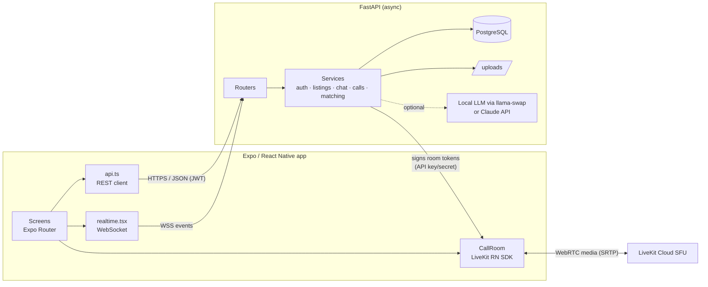
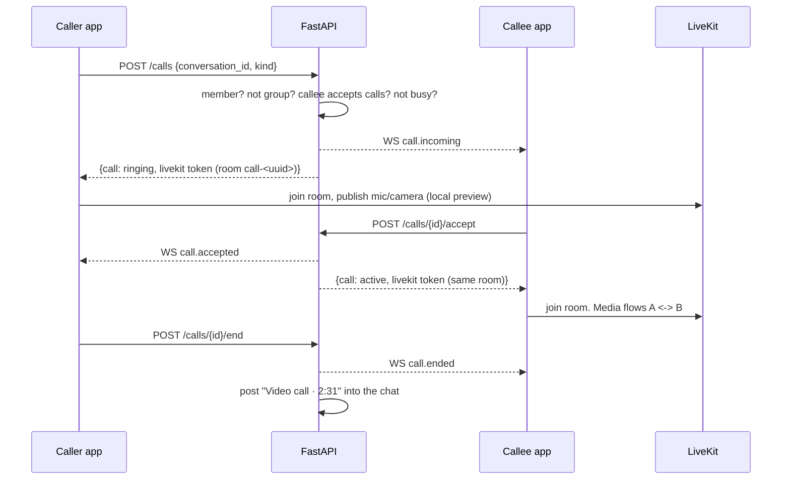

# Architecture and technical decisions

## Overview



There are three channels:

1. **REST** for all state changes: listings, messages, call transitions.
2. **WebSocket (`/ws`)**, server to client only, for live events (`message.new`, `call.incoming`, `call.accepted`, …). Keeping the socket push-only means every write goes through one validated, authenticated path.
3. **LiveKit**, used only for audio/video media. The backend never touches media. It mints short-lived, room-scoped join tokens.

## Calling design (the key requirement)

**Why LiveKit.** Raw WebRTC needs signaling, STUN/TURN, and an SFU or mesh, all of which are hard to make reliable across Indian mobile networks in five days. LiveKit gives a production-grade SFU with TURN, a maintained React Native SDK, and an Expo config plugin. Agora and Stream were the alternatives. LiveKit was chosen because it is open source (so it can be self-hosted later; `docker compose --profile livekit` already runs it), and because its token model fits a backend that owns authorization.

**Signaling is ours, media is LiveKit's.** Ringing, accept, reject and busy are product logic, so they live in FastAPI and Postgres. That keeps an auditable call log and lets the backend enforce who may call whom.



### State machine

`services/call_service.py`:

```
ringing --accept-->  active --end--> ended
ringing --reject-->  rejected
ringing --caller hangs up--> cancelled
ringing --35 s no answer--> missed
```

- **Race safety.** Every transition is a conditional `UPDATE … WHERE status = 'ringing'`. If an accept, a decline and the timeout land at once, exactly one wins; the others get `409 This call is no longer ringing`.
- **Timeout.** An `asyncio` task per call marks it missed and notifies both sides.
- **Busy and stale calls.** A callee already ringing or in an active call (less than 3 h old) is reported busy. A caller's own leftover live calls (for example, after the app was killed mid-call) are closed before a new one starts.
- **Idempotent hang-up.** `end` on a finished call just returns the final state.
- **Client robustness.**
  - If the remote participant drops out of the LiveKit room during an active call, the app ends the call.
  - Leaving the call screen any other way, such as the Android back button, also hangs up.
  - The WebSocket reconnects with backoff, pings every 25 s, and reconnects when the app returns to the foreground.

### Privacy in calls

- Calls exist only inside a conversation the caller belongs to.
- LiveKit identity = user UUID, display name = chosen name. No phone number or email ever reaches the other device.
- A per-user "accept in-app calls" switch returns `403` to callers.
- Tokens are scoped to one room and expire after 2 h.

### Meeting rooms

Group chats get a join-anytime room (`meeting-<conversation id>`) rather than ringing. This is simpler and closer to how a buyer, seller and broker would actually meet. The same `CallRoom` component renders a grid when more than two people are present.

## Backend structure

- **Thin routers, logic in services.** Routers only parse input, apply dependencies (`CurrentUser`, `ListingManager` role guard) and call a service. Services raise domain errors (`NotFound`, `Forbidden`, `Conflict`), which `main.py` maps to HTTP codes.
- **Pydantic everywhere.** Request and response models live in `schemas.py`. Endpoints never return raw dicts or ORM objects. `PublicUser` (id, name, role) is the only user shape other people ever see.
- **Async throughout.** asyncpg, async SQLAlchemy 2, `anyio` for file writes.
- **Viewer-aware serialization.** `listing_service.to_out(listing, viewer)` computes `is_mine` and blurs the pin to about 1 km (2 decimal places) for non-owners when the owner enabled "hide exact location".
- **Portable schema.** UUID keys and enums stored as `VARCHAR + CHECK`, so the same models run on Postgres (prod) and SQLite (tests). Alembic manages migrations.
- **Efficient chat list.** The last message per conversation comes from one window-function query (`row_number() over (partition by conversation_id)`), not N+1 queries.

### Role-based access

| Action | Buyer | Seller | Broker |
|---|---|---|---|
| Browse, map, chat, call, meeting rooms, AI match | ✓ | ✓ | ✓ |
| Create listings | | ✓ | ✓ |
| Edit, delete or mark sold | | own only | own only |

Enforcement is server-side (`require_roles` dependency plus ownership checks). The app hides controls only for UX.

## AI-assisted buyer-to-parcel matching

`POST /match {query}` runs in two stages:

1. **Understand.** Three interchangeable extractors implement one `RequirementExtractor` protocol, chosen by config: `LocalLLMExtractor` (when `LLM_BASE_URL` is set; a self-hosted Qwen2.5-7B behind llama-swap's OpenAI-compatible API, using JSON-schema output from the same Pydantic model), else `ClaudeExtractor` (when `ANTHROPIC_API_KEY` is set), else `RuleExtractor`. The demo runs the local model: it keeps buyer text on our own server and costs nothing per request. A 7B model makes mistakes (it can omit the budget or invent must-haves), so its output is repaired: missing budget/area values are filled from the rule parser and must-haves unrelated to the query are dropped. Any error or invalid output falls back to rules. `ClaudeExtractor` asks Claude, via structured outputs with the Pydantic `BuyerRequirements` schema as the response format, to turn free text into budget, area range, locations and must-haves. It handles lakh/crore, guntas and phrasing like "under". If no API key is set or the call fails, the deterministic `RuleExtractor` (regexes for "2.5 cr", "5-10 acres", known localities, feature keywords) takes over. The API response says which parser ran.
2. **Rank.** `scorer.py` scores price (35), area (30), location (25) and features (10), using only the dimensions the buyer specified, normalized to 0–100. Location uses exact locality matches or the haversine distance to a small gazetteer of Bengaluru-region towns, so "near Hoskote" also surfaces a parcel in Malur 17 km away. Every score comes with human-readable reasons.

The LLM is used only for language understanding. Ranking is deterministic and explainable, which matters for a high-value purchase.

Next step: embed listing descriptions (pgvector) for semantic must-haves, and learn the weights from which matches lead to chats and calls.

## Mobile structure

- **Expo Router.** File-based routes; `Stack.Protected` guards switch between auth and app stacks. Call screens are `fullScreenModal`s.
- **`lib/realtime.tsx`.** One WebSocket per session, plus a tiny pub/sub hook (`useRealtime`) that screens subscribe to.
- **`lib/callStore.ts`.** An external store (`useSyncExternalStore`) holding the current call session and any ringing call. A root-level `CallCoordinator` routes `call.incoming` to the ringing screen from anywhere in the app.
- **`components/CallRoom.tsx`.**
  - Requests mic and camera permissions.
  - Configures the audio session: speaker for video, earpiece for voice.
  - Renders remote video full screen with a local picture-in-picture, or a grid in meetings.
  - Provides mute, camera, flip, speaker and hang-up controls.
- **Maps.** Leaflet in a WebView avoids a Google Maps API key and billing setup. The same component does markers, approximate-area circles and a draggable pin picker.

## Challenges and how they were handled

| Challenge | Approach |
|---|---|
| Calls must work on real devices on mobile data | Managed SFU with TURN (LiveKit Cloud) instead of peer-to-peer WebRTC |
| Accept, reject and timeout racing each other | Conditional UPDATEs; exactly one transition wins |
| Ghost "busy" state after a crash | Stale-call cleanup for the caller and a 3 h cutoff for active calls |
| Native modules vs Expo | Config plugins (`@livekit/react-native-expo-plugin`, `@config-plugins/react-native-webrtc`) and an EAS development build; no hand-edited native code |
| Verifying calls without two phones in CI | Backend tests cover the state machine; an end-to-end script joined two real LiveKit clients with backend-issued tokens and confirmed each saw the other's audio track |
| Exposing land locations safely | Optional ~1 km location blurring for non-owners |

## What I'd do next

1. Push-based ringing: FCM data messages plus `react-native-callkeep` (CallKit/ConnectionService), so a locked phone rings.
2. LiveKit webhooks (`participant_left`, `room_finished`) to reconcile call state server-side.
3. Redis pub/sub for WebSocket fan-out across API instances; S3 for images.
4. Refresh tokens, rate limiting, and "LandConnect Approved" verification badges for brokers.
